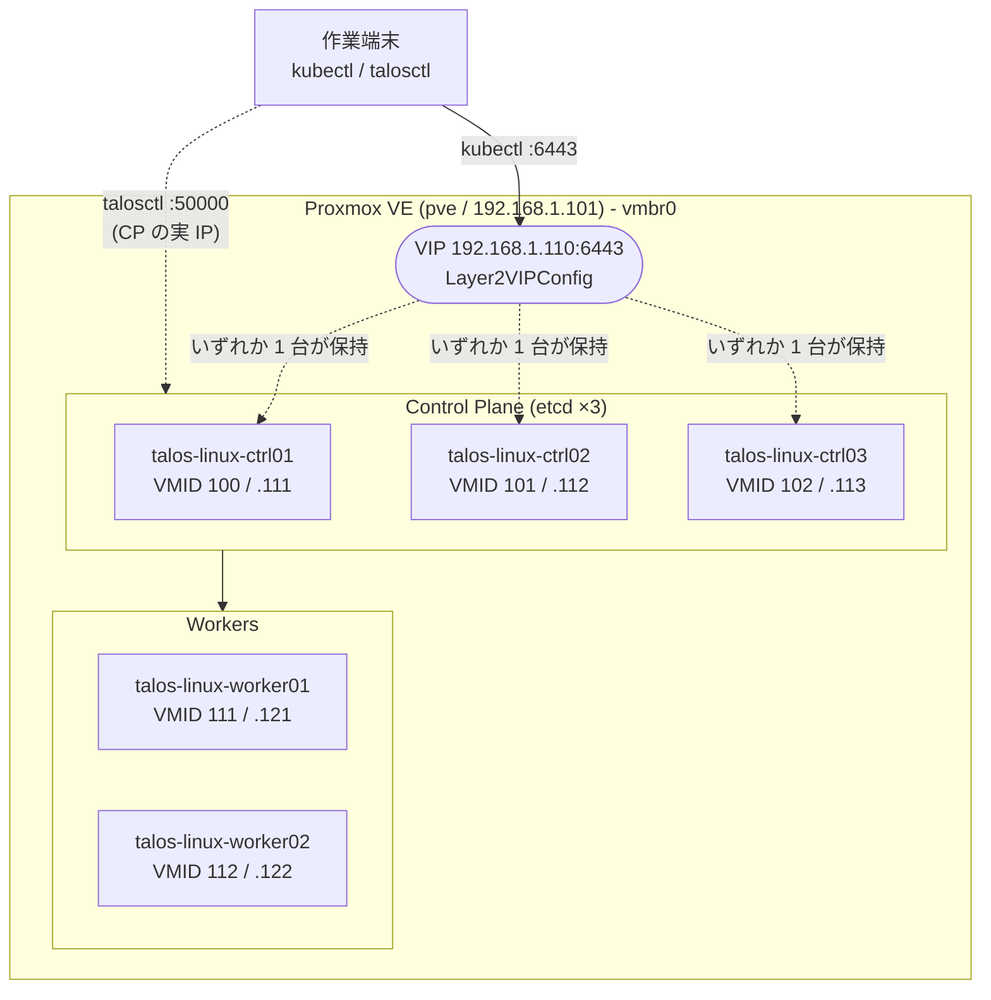

# Proxmox 上の HA Talos クラスタ

Proxmox VE 上の VM 5 台（コントロールプレーン 3 台 + ワーカー 2 台）で Talos Linux の HA クラスタを動かす構成。Kubernetes API のエンドポイントは、Talos 組み込みの Layer2 VIP で冗長化する。

Proxmox ホストは 1 台なので、物理ホストの障害には耐えられない。この構成で確かめられるのは、VM / OS の障害への耐性と、ノード単位のローリング再起動・アップグレード。

## 構成



| VMID | 名前 | 役割 | IP | vCPU / RAM / ディスク |
|---|---|---|---|---|
| 100 | talos-linux-ctrl01 | controlplane | 192.168.1.111 | 2 / 4GB / 50GB |
| 101 | talos-linux-ctrl02 | controlplane | 192.168.1.112 | 2 / 4GB / 20GB |
| 102 | talos-linux-ctrl03 | controlplane | 192.168.1.113 | 2 / 4GB / 20GB |
| 111 | talos-linux-worker01 | worker | 192.168.1.121 | 2 / 4GB / 50GB |
| 112 | talos-linux-worker02 | worker | 192.168.1.122 | 2 / 4GB / 50GB |

| 項目 | 値 |
|---|---|
| クラスタ名 | `talos-ha` |
| エンドポイント | `https://192.168.1.110:6443`（VIP） |
| GW / DNS | `192.168.1.1` |
| Talos / Kubernetes | v1.14.6 / v1.37.1 |
| CNI | Cilium 1.20.5（kube-proxy を置き換え、Hubble Relay / UI を有効化） |
| NTP | `ntp.nict.jp` |

ctrl01 は [stand-alone](../stand-alone/) 構成の VM をリセットして使い回しているため、ディスクが 50GB になっている。

## ファイル

```
gen-config.sh              # machine config の生成（secrets.yaml があれば再利用する）
patches/common.yaml        # 全ノード共通: NTP, DNS
patches/controlplane.yaml  # CP 共通: Layer2 VIP
patches/cilium.yaml        # CP 共通: Flannel と kube-proxy の無効化
nodes/<ノード名>.yaml       # ノードごと: ホスト名, 静的 IP
cilium/values.yaml         # Cilium の helm values（Talos 向け）
_out/                      # 生成物（gitignore 対象・秘密鍵を含む）
```

`gen config` で役割ごとの共通設定（`controlplane.yaml` / `worker.yaml`）を作り、そこに `talosctl machineconfig patch` でノードごとのパッチを当てて `_out/<ノード名>.yaml` を作る。

ノードの一覧と役割は `nodes/` のファイル名で決まる（`ctrl*.yaml` は controlplane、`worker*.yaml` は worker）。ノードを増やすときは `nodes/` にファイルを足すだけでよい。

`talosconfig` の接続先は VIP ではなく CP の実 IP にしている。VIP は etcd が正常なときしか動かないため、障害時に Talos API へ入れなくなるのを避けるため。接続先の IP は `nodes/ctrl*.yaml` から読み取る。

`_out/secrets.yaml` はクラスタの CA と鍵そのもの。リポジトリ外にバックアップしておく。`gen-config.sh` は `secrets.yaml` がないと新しく作るため、失ったまま実行すると、既存のクラスタを管理できない設定ができてしまう。

## 構築手順

`talosctl` は v1.14.6 を使う。インストールされる Talos のバージョンは ISO（1.14.5）ではなく、手元の `talosctl` のバージョンで決まる（インストーラーのイメージがそのバージョンになる）。Cilium を入れるために `helm` と `cilium` CLI も使う（`brew install helm cilium-cli`）。コマンドはこのディレクトリで実行する。

固定 IP（`.110`〜`.122`）はルーターの DHCP の払い出し範囲に入っている（[既知の問題](#固定-ip-がルーターの-dhcp-の払い出し範囲に入っている)）。構築を始める前に、これらの IP、特に VIP の `.110` が使われていないことを確認する。

### 1. VM の作成

#### ctrl01（stand-alone 構成の VM を使い回す場合）

[stand-alone](../stand-alone/) のクラスタを消して、メンテナンスモードに戻す。stand-alone のクラスタはここで消える。

```bash
talosctl --talosconfig ../stand-alone/_out/talosconfig -n 192.168.1.111 -e 192.168.1.111 \
  reset --graceful=false --reboot \
  --system-labels-to-wipe STATE --system-labels-to-wipe EPHEMERAL
```

インストール済みの Talos がディスクから起動し、設定がないのでメンテナンスモードになる（ISO は不要）。IP は DHCP で付く。

新しく VM を作る場合は、下の `qm create` のループに `"100 talos-linux-ctrl01 20"` を足す。

#### ctrl02 以降

Proxmox のシェルで実行する。ISO は `local:iso/talos-linux-1.14.5.iso` を使う。

```bash
for spec in "101 talos-linux-ctrl02 20" "102 talos-linux-ctrl03 20" "111 talos-linux-worker01 50" "112 talos-linux-worker02 50"; do
  set -- $spec
  qm create $1 --name $2 \
    --sockets 2 --cores 1 --cpu x86-64-v2-AES --memory 4096 \
    --net0 virtio,bridge=vmbr0 \
    --scsihw virtio-scsi-single --scsi0 local-lvm:$3,iothread=1 \
    --ide2 local:iso/talos-linux-1.14.5.iso,media=cdrom \
    --boot 'order=scsi0;ide2;net0' --ostype l26
  qm start $1
done
```

メンテナンスモードでは DHCP で IP が付く。コンソールで IP を手で設定する必要はない。MAC アドレスから仮の IP を探す。

```bash
# Proxmox で MAC を確認する
for id in 100 101 102 111 112; do echo "$id $(qm config $id | grep -oP 'virtio=\K[^,]+')"; done
```

macOS の `arp` は MAC を小文字で、各オクテットの先頭の 0 を省いて表示する（`BC:24:11:02:2A:03` は `bc:24:11:2:2a:3`）。次のように書式を揃えてから照合する。

```bash
# 手元でサブネットに ping を打って ARP テーブルを埋める
for i in $(seq 1 254); do ping -c1 -t1 192.168.1.$i >/dev/null 2>&1 & done; wait

# Proxmox で確認した MAC から仮の IP を引く
mac2ip() {
  local m=$(echo "$1" | tr 'A-Z' 'a-z' | sed -E 's/(^|:)0([0-9a-f])/\1\2/g')
  arp -an | grep " at $m " | grep -oE '\([0-9.]+\)' | tr -d '()'
}
mac2ip BC:24:11:02:2A:03
```

ARP テーブルには古いエントリが残るため、1 つの MAC に複数の IP が出ることがある。そのときは `talosctl -n <IP> -e <IP> get disks --insecure` に応答する IP がメンテナンスモードのもの。

### 2. 設定ファイルの生成

```bash
./gen-config.sh
```

### 3. 設定の適用

各ノードの仮の IP に対して実行する。適用するとインストールと再起動が行われ、`nodes/` で指定した固定 IP に切り替わる。

```bash
talosctl apply-config --insecure -n <仮IP> -e <仮IP> -f _out/ctrl01.yaml
# ctrl02, ctrl03, worker01, worker02 も同様
```

DHCP で付いた仮の IP が、他のノードの固定 IP と同じになることがある。その場合は、そのノードに先に適用して IP を空けてから、他のノードに適用する。

### 4. bootstrap と kubeconfig の取得

```bash
export TALOSCONFIG=$PWD/_out/talosconfig

talosctl -n 192.168.1.111 bootstrap    # etcd の初期化。クラスタ作成時に 1 回、1 台だけで実行する

# API が起動するまで数分かかる。CNI がないうちは talosctl health が通らないので、API の応答を待つ
export KUBECONFIG=$PWD/_out/kubeconfig
until talosctl kubeconfig _out/kubeconfig --force 2>/dev/null &&
      kubectl get --raw /readyz --request-timeout=3s >/dev/null 2>&1; do sleep 10; done
kubectl get nodes
```

この時点では CNI がないため、ノードは `NotReady`、CoreDNS は `Pending` になる。

### 5. Cilium のインストール

```bash
helm repo add cilium https://helm.cilium.io/
helm repo update cilium
helm upgrade --install cilium cilium/cilium --version 1.20.5 \
  -n kube-system -f cilium/values.yaml --wait --timeout 10m
cilium status

talosctl -n 192.168.1.111 health \
  --control-plane-nodes 192.168.1.111,192.168.1.112,192.168.1.113 \
  --worker-nodes 192.168.1.121,192.168.1.122 \
  --wait-timeout 15m
kubectl get nodes -o wide
```

`values.yaml` の主な設定:

- `kubeProxyReplacement: true`: kube-proxy の代わりに Cilium が eBPF で Service を処理する
- `k8sServiceHost: localhost` / `k8sServicePort: 7445`: kube-proxy がない状態で API server に届くよう、各ノードの KubePrism を使う
- `securityContext.capabilities`: Talos はカーネルモジュールのロードを許可しないため、デフォルトから `SYS_MODULE` を外している
- `cgroup.autoMount.enabled: false` / `cgroup.hostRoot: /sys/fs/cgroup`: Talos がマウント済みの cgroupv2 を使う

Cilium の設定を変えるときは、`values.yaml` を編集して同じ `helm upgrade --install` を実行する。

#### Flannel で動いているクラスタからの移行

既存のクラスタに `gen-config.sh` で作り直した設定を `apply-config` しても、Talos はデプロイ済みの Flannel と kube-proxy を削除しない。そのまま Cilium を入れると、CNI が 2 つ動き、kube-proxy の iptables ルールと Cilium の eBPF の Service 処理が重なる。

移行するときは、全ノードを `talosctl reset --graceful=false --reboot --system-labels-to-wipe STATE --system-labels-to-wipe EPHEMERAL` でメンテナンスモードに戻し、手順 3 からやり直す（`_out/secrets.yaml` を残しておけば同じ CA で作り直せる）。

## 動作確認

### Cilium

```bash
# kube-proxy の置き換えが有効になっているか
kubectl -n kube-system exec ds/cilium -c cilium-agent -- cilium-dbg status | grep KubeProxyReplacement

# Hubble UI をブラウザで開く（http://localhost:12000）
cilium hubble ui
```

Service 経由の通信は、nginx の Deployment と Service を作り、ワーカー上の Pod から `curl http://web.<namespace>.svc.cluster.local` で確認できる。コントロールプレーンには `NoSchedule` の taint があるので、テスト用の Pod はワーカーに置く。

2026-11-21 の確認結果: `cilium status` で全コンポーネントが OK（cilium / cilium-envoy 5/5、operator 2/2、hubble-relay・hubble-ui 1/1）。`KubeProxyReplacement: True`。worker01 上の Pod から、worker01 / worker02 の nginx への Service 経由の HTTP が 6 回とも 200 を返した。

### VIP のフェイルオーバー

VIP を持っているノードを確認し、そのノードを再起動する。再起動中も VIP 経由で API に届くことを確認する。

```bash
talosctl -n 192.168.1.111,192.168.1.112,192.168.1.113 get addresses | grep 192.168.1.110
talosctl -n <VIP を持っているノード> reboot --wait=false
while :; do kubectl get --raw /readyz --request-timeout=2s && echo " $(date +%T)"; sleep 2; done
```

2026-11-21 の確認結果:

| CNI | 再起動したノード | VIP の移動先 | VIP 経由の `/readyz`（約 3 分監視） |
|---|---|---|---|
| Flannel + kube-proxy | ctrl01 | 即座に ctrl03 | 失敗なし |
| Cilium（kube-proxy 置き換え） | ctrl03 | 即座に ctrl01 | 失敗なし |

`talosctl reboot` は graceful なシャットダウンなので VIP がすぐに手放される。Proxmox の `qm stop` などで強制停止した場合は、VIP が移るまでに数十秒かかる見込み（未確認）。

Cilium の構成で再起動したとき、cilium-operator の Pod がシャットダウン中の ctrl03 に何度もスケジュールされ、`NodeShutdown` で拒否された Pod が 74 個残った（[既知の問題](#ノードの再起動で-cilium-operator-の失敗-pod-が大量に残る)）。

計画的に再起動するときは、先に drain しておくと、この問題を避けられる見込み（未確認）。

```bash
kubectl drain <ノード名> --ignore-daemonsets --delete-emptydir-data
talosctl -n <IP> reboot
kubectl uncordon <ノード名>
```

## 既知の問題

### 固定 IP がルーターの DHCP の払い出し範囲に入っている

構築時、ctrl03 に DHCP で `192.168.1.112`（ctrl02 の固定 IP）が割り当てられた。`192.168.1.110`〜`.122` はルーターの DHCP の払い出し範囲に含まれている。PoC なのでこのまま使っているが、ルーターが他の機器にこれらの IP を払い出すと、ノードや VIP と IP がぶつかる。

特定のノードや VIP にときどき届かなくなったら、まず IP の衝突を疑う。恒久的には、ルーターの DHCP の払い出し範囲から `192.168.1.100`〜`.149` を外す。

### ノードの再起動で cilium-operator の失敗 Pod が大量に残る

cilium-operator はすべての taint を許容し、2 つのレプリカが別のノードに載るよう anti-affinity が設定されている。`talosctl reboot` はノードを cordon せずに止めるので、スケジューラはシャットダウン中のノードを候補から外さない。その結果、operator の Pod がそのノードに何度もスケジュールされ、kubelet に `NodeShutdown` で拒否された Pod が残る。

operator 自体は残りのレプリカで動き続け、再起動後にそのノードでも起動し直すので、クラスタの動作には影響しない。`cilium status` の Operator 欄に errors が出るだけ。失敗した Pod は次のように削除する。

```bash
kubectl delete pods -A --field-selector=status.phase=Failed
```

再起動する前に drain しておけば避けられる見込み（未確認）。
