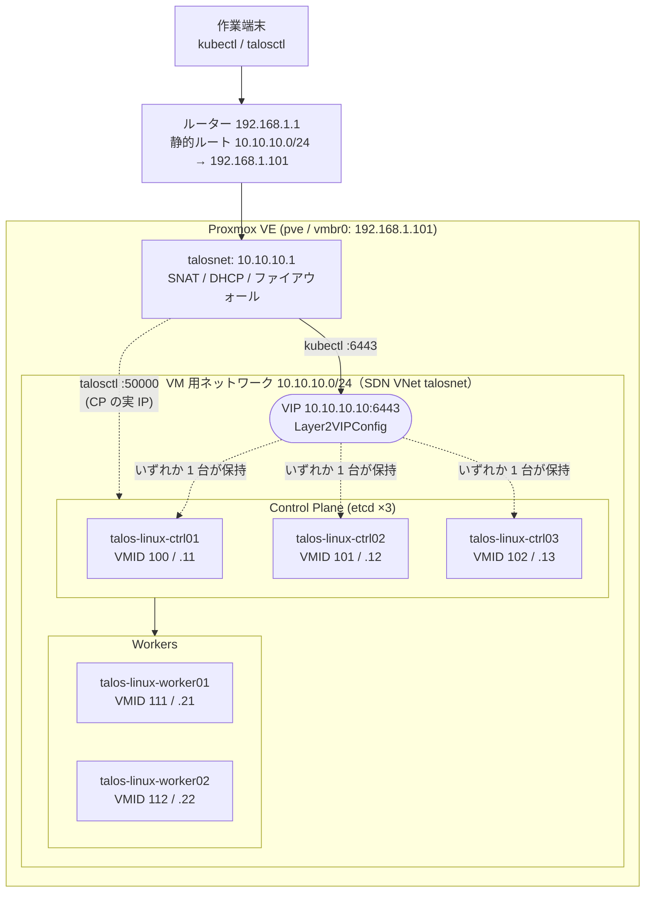

# Proxmox 上の HA Talos クラスタ

Proxmox VE 上の VM 5 台（コントロールプレーン 3 台 + ワーカー 2 台）で Talos Linux の HA クラスタを動かす構成。Kubernetes API のエンドポイントは、Talos 組み込みの Layer2 VIP で冗長化する。

VM は、ホームネットワーク（`192.168.1.0/24`）とは別の、Proxmox SDN で作った VM 用ネットワーク（`10.10.10.0/24`）に置く。ホームネットワークは Proxmox の管理用として使う。

Proxmox ホストは 1 台なので、物理ホストの障害には耐えられない。この構成で確かめられるのは、VM / OS の障害への耐性と、ノード単位のローリング再起動・アップグレード。

## 構成



| VMID | 名前 | 役割 | IP | vCPU / RAM / ディスク |
|---|---|---|---|---|
| 100 | talos-linux-ctrl01 | controlplane | 10.10.10.11 | 2 / 4GB / 20GB |
| 101 | talos-linux-ctrl02 | controlplane | 10.10.10.12 | 2 / 4GB / 20GB |
| 102 | talos-linux-ctrl03 | controlplane | 10.10.10.13 | 2 / 4GB / 20GB |
| 111 | talos-linux-worker01 | worker | 10.10.10.21 | 2 / 4GB / 50GB |
| 112 | talos-linux-worker02 | worker | 10.10.10.22 | 2 / 4GB / 50GB |

| 項目 | 値 |
|---|---|
| クラスタ名 | `talos-ha` |
| エンドポイント | `https://10.10.10.10:6443`（VIP） |
| VM 用ネットワーク | `10.10.10.0/24`（SDN の Simple ゾーン `talos` / VNet `talosnet`） |
| ゲートウェイ | `10.10.10.1`（Proxmox ホスト。外向きの通信は `192.168.1.101` に SNAT する） |
| DHCP の払い出し範囲 | `10.10.10.100`〜`.200`（SDN の dnsmasq。メンテナンスモードの仮の IP に使う） |
| DNS | `192.168.1.1`（ホームネットワークのルーター） |
| Proxmox VE | 9.2.2 |
| Talos / Kubernetes | v1.14.6 / v1.37.1 |
| CNI | Cilium 1.20.5（kube-proxy を置き換え、Hubble Relay / UI を有効化） |
| NTP | `ntp.nict.jp` |

### VM 用ネットワークのファイアウォール

VM からホームネットワークの機器には届かないようにしている。Proxmox のファイアウォール（nftables 版の proxmox-firewall）で、次のように制限する。

| 通信 | 扱い |
|---|---|
| VM 同士 | 通す |
| VM → インターネット | 通す |
| VM → DNS（`192.168.1.1:53`） | 通す |
| VM → そのほかのプライベートアドレス・CGNAT のアドレス（ルーター、作業端末など） | 落とす |
| VM → Proxmox ホスト | DHCP と ICMP だけ通す（Web UI や SSH には入れない） |
| VM から、送信元が `10.10.10.0/24` 以外の通信 | 落とす（送信元の偽装対策。ファイアウォールではなく `rp_filter` で止める） |
| ホームネットワーク → VM | 通す |

ルーターに静的ルートを入れているので、VM に届くのは作業端末だけではない。ホームネットワークのどの機器からも、Kubernetes API（6443）、Talos API（50000）、NodePort などに届く。

ルーターの WAN 側のグローバル IP 宛ては止めていない。ルーターによっては、そこから管理画面に届く。WAN 側の IP は変わりうるので、ルールには入れていない。

## ファイル

```
gen-config.sh              # machine config の生成（secrets.yaml があれば再利用する）
patches/common.yaml        # 全ノード共通: NTP, DNS
patches/controlplane.yaml  # CP 共通: Layer2 VIP
patches/cilium.yaml        # CP 共通: Flannel と kube-proxy の無効化
nodes/<ノード名>.yaml       # ノードごと: ホスト名, 静的 IP
cilium/values.yaml         # Cilium の helm values（Talos 向け）
_out/                      # 生成物（gitignore 対象・秘密鍵を含む）
```

`gen config` で役割ごとの共通設定（`controlplane.yaml` / `worker.yaml`）を作り、そこに `talosctl machineconfig patch` でノードごとのパッチを当てて `_out/<ノード名>.yaml` を作る。

ノードの一覧と役割は `nodes/` のファイル名で決まる（`ctrl*.yaml` は controlplane、`worker*.yaml` は worker）。ノードを増やすときは `nodes/` にファイルを足すだけでよい。

`talosconfig` の接続先は VIP ではなく CP の実 IP にしている。VIP は etcd が正常なときしか動かないため、障害時に Talos API へ入れなくなるのを避けるため。接続先の IP は `nodes/ctrl*.yaml` から読み取る。

`_out/secrets.yaml` はクラスタの CA と鍵そのもの。リポジトリ外にバックアップしておく。`gen-config.sh` は `secrets.yaml` がないと新しく作るため、失ったまま実行すると、既存のクラスタを管理できない設定ができてしまう。

## 構築手順

`talosctl` は v1.14.6 を使う。インストールされる Talos のバージョンは ISO ではなく、手元の `talosctl` のバージョンで決まる（インストーラーのイメージがそのバージョンになる）。Cilium を入れるために `helm` と `cilium` CLI も使う（`brew install helm cilium-cli`）。手元のコマンドはこのディレクトリで実行する。

### 1. VM 用ネットワークの作成

Proxmox のシェルで実行する。

#### SDN（ゾーン・VNet・サブネット）

SDN の DHCP には dnsmasq を使う。標準の `dnsmasq.service` は止め、SDN が作るゾーンごとのサービス（`dnsmasq@talos`）だけを動かす。

```bash
apt install -y dnsmasq
systemctl disable --now dnsmasq

pvesh create /cluster/sdn/zones --type simple --zone talos --dhcp dnsmasq --ipam pve
pvesh create /cluster/sdn/vnets --vnet talosnet --zone talos
pvesh create /cluster/sdn/vnets/talosnet/subnets --type subnet --subnet 10.10.10.0/24 \
  --gateway 10.10.10.1 --snat 1 \
  --dhcp-range start-address=10.10.10.100,end-address=10.10.10.200 \
  --dhcp-dns-server 192.168.1.1
pvesh set /cluster/sdn    # 設定を反映する

echo "net.ipv4.ip_forward = 1" > /etc/sysctl.d/99-ip-forward.conf
sysctl -p /etc/sysctl.d/99-ip-forward.conf
```

ゾーンと VNet の名前は 8 文字まで。

#### ファイアウォール

ここでは、入れたばかりの Proxmox を前提に、`host.fw` と `cluster.fw` を丸ごと書き換える。すでにファイアウォールのルールがあるホストでは、上書きせずに、既存のファイルに追記する。

ホストのルールを書く。

```bash
cat > /etc/pve/nodes/pve/host.fw <<'EOF'
[OPTIONS]
nftables: 1

[RULES]
IN ACCEPT -i talosnet -p udp -dport 67 # Talos VM: DHCP (SDN dnsmasq)
IN ACCEPT -i talosnet -p icmp # Talos VM: ping to gateway
FORWARD ACCEPT -source 10.10.10.0/24 -dest 10.10.10.0/24 # Talos VM: VM to VM
FORWARD ACCEPT -source 10.10.10.0/24 -dest 192.168.1.1 -p udp -dport 53 # Talos VM: DNS
FORWARD ACCEPT -source 10.10.10.0/24 -dest 192.168.1.1 -p tcp -dport 53 # Talos VM: DNS
FORWARD DROP -source 10.10.10.0/24 -dest 192.168.0.0/16 # Talos VM: no access to home network
FORWARD DROP -source 10.10.10.0/24 -dest 172.16.0.0/12
FORWARD DROP -source 10.10.10.0/24 -dest 10.0.0.0/8
FORWARD DROP -source 10.10.10.0/24 -dest 100.64.0.0/10
FORWARD DROP -source 10.10.10.0/24 -dest 169.254.0.0/16
EOF
```

FORWARD のルールは送信元アドレスで判定するので、送信元を偽った通信（たとえば Pod の `10.244.0.0/16` のアドレスのまま出た通信）はすり抜ける（2026-11-22 に確認）。これはカーネルの逆経路フィルタ（`rp_filter`）で止める。`talosnet` から届いた通信のうち、送信元へ返す経路が `talosnet` を通らないもの（送信元が `10.10.10.0/24` 以外）を落とす。

```bash
cat > /etc/sysctl.d/zz-talosnet-rp-filter.conf <<'EOF'
# Talos VM の送信元の偽装を止める（talosnet だけ厳密な逆経路フィルタにする）
# 実際の値は all とインターフェースごとの値の大きいほう。pve-firewall.conf が all を 2 にするので 0 に戻す（このファイルは pve-firewall.conf より後に読ませるため zz- で始める）
net.ipv4.conf.all.rp_filter = 0
net.ipv4.conf.talosnet.rp_filter = 1
EOF
/usr/lib/systemd/systemd-sysctl
sysctl net.ipv4.conf.all.rp_filter net.ipv4.conf.talosnet.rp_filter   # 0 と 1 になっていること
```

- `rp_filter` の実際の値は、`all` とインターフェースごとの値の大きいほうになる。`/usr/lib/sysctl.d/pve-firewall.conf` が `all` を `2`（緩いモード）にしているので、`all` を `0` にしないと `talosnet` を厳密にできない。ほかのインターフェースは個別の値（`2`）のままなので、動きは変わらない
- sysctl の設定ファイルはファイル名の順に読まれ、あとのファイルが勝つ。`99-` で始めると `pve-firewall.conf` より先に読まれ、全体が読み直されたときに `all` が `2` に戻る（2026-11-22 に起きた）
- 起動時に sysctl が読まれる時点では、`talosnet` はまだない。`talosnet` の値は、SDN がインターフェースを作ったときに udev が `systemd-sysctl --prefix=/net/ipv4/conf/talosnet` を実行して当てる（`/usr/lib/udev/rules.d/99-systemd.rules`）。Proxmox を再起動したあとは、上の `sysctl` で `0` と `1` になっていることを確かめる（2026-11-22 に再起動して確認済み。[Proxmox の再起動](#proxmox-の再起動) を参照）

ファイアウォールを有効にする。締め出されたときのために、直前に 10 分で無効に戻すタイマーを仕掛けておく。

```bash
systemd-run --on-active=600 --unit=fw-rollback \
  /bin/sh -c 'printf "[OPTIONS]\nenable: 0\n" > /etc/pve/firewall/cluster.fw'

cat > /etc/pve/firewall/cluster.fw <<'EOF'
[OPTIONS]
enable: 1
EOF
```

作業端末から SSH と Web UI に入れることを確かめたら、タイマーを止める。止め忘れると、10 分後にファイアウォールが何の表示もなく無効になる。

```bash
systemctl stop fw-rollback.timer
systemctl list-timers --all | grep fw-rollback   # 何も出ないこと
grep enable /etc/pve/firewall/cluster.fw          # enable: 1 のままであること
```

- ファイアウォールを有効にすると、Proxmox ホストへの通信は管理用のもの（SSH、Web UI など）だけが通る。管理用の通信を受け付ける範囲は、ホストの IP から自動で検出される（`pve-firewall localnet` で `192.168.1.0/24` になっていることを確認しておく）
- 制限は VNet のファイアウォール（`/etc/pve/sdn/firewall/talosnet.fw`）ではなく、ホストの FORWARD ルールに書く。VNet のルールは同じブリッジ内の通信にしかかからず、Proxmox がルーティングしてホームネットワークに出す通信は止められなかった
- FORWARD のルールには、受信したインターフェース（`-i talosnet`）を書けない。書くと proxmox-firewall が `cannot define interfaces for forward direction` とログに出して、そのルールを読み飛ばす。ルールの中でアドレスを否定する書き方（`!`）もない。そのため、送信元の偽装は上の `rp_filter` で止めている
- VM 同士の通信は、同じブリッジ内で済むので今は FORWARD を通らない。ブリッジの通信もファイアウォールにかける設定（`br_netfilter`）になったときに `10.0.0.0/8` の DROP で止まらないよう、VM 同士を通すルールを先に書いている
- ファイアウォールを有効にしたあとは、`pve-firewall status` が `pending changes` と表示する。旧来の iptables 版の表示で、iptables 側にはルールがないので無視してよい

#### ルーターの静的ルート

作業端末から VM 用ネットワークに届くよう、ルーターに静的ルートを入れる。

| 宛先 | サブネットマスク | ゲートウェイ |
|---|---|---|
| `10.10.10.0` | `255.255.255.0` | `192.168.1.101` |

行き（作業端末 → ルーター → Proxmox → VM）と帰り（VM → Proxmox → 作業端末）で経路が変わる。今のルーターでは TCP も問題なく通ったが、ルーターのファイアウォールが通信の状態を追っていると、帰りが見えないために TCP を落とし、`kubectl` や `talosctl` が途中で止まることがある。

ルーターに入れられない場合や、TCP が止まる場合は、作業端末に直接ルートを入れる（行きも帰りもルーターを通らなくなる）。

```bash
sudo route -n add -net 10.10.10.0/24 192.168.1.101
```

macOS の `route add` で入れたルートは、再起動やネットワークのつなぎ直しで消える。そのたびに入れ直す。

### 2. VM の作成

Proxmox のシェルで実行する。ISO は [Image Factory](https://factory.talos.dev/) の素のイメージ（拡張機能なし）を使う。

```bash
cd /var/lib/vz/template/iso
curl -fL -o talos-linux-1.14.6.iso \
  https://factory.talos.dev/image/376567988ad370138ad8b2698212367b8edcb69b5fd68c80be1f2ec7d603b4ba/v1.14.6/metal-amd64.iso

for spec in "100 talos-linux-ctrl01 20" "101 talos-linux-ctrl02 20" "102 talos-linux-ctrl03 20" "111 talos-linux-worker01 50" "112 talos-linux-worker02 50"; do
  set -- $spec
  qm create $1 --name $2 \
    --sockets 2 --cores 1 --cpu x86-64-v2-AES --memory 4096 \
    --net0 virtio,bridge=talosnet \
    --scsihw virtio-scsi-single --scsi0 local-lvm:$3,iothread=1 \
    --ide2 local:iso/talos-linux-1.14.6.iso,media=cdrom \
    --boot 'order=scsi0;ide2;net0' --ostype l26
  qm start $1
done
```

メンテナンスモードでは DHCP で仮の IP が付く。SDN の DHCP は、IPAM（Proxmox の IP 管理）に登録された MAC にしか IP を配らない。VM を VNet につなぐと自動で登録されるので、仮の IP は IPAM から確認できる。

```bash
pvesh get /cluster/sdn/ipams/pve/status --output-format json |
  python3 -c 'import json,sys; [print(e.get("vmid","-"), e.get("mac","-"), e["ip"]) for e in json.load(sys.stdin)]'
```

IPAM に載るのは DHCP の仮の IP だけで、手順 4 で固定 IP に切り替えたあとも、仮の IP（`.100`〜）が表示されたままになる。固定 IP（`.10`〜`.22`）は IPAM に登録していない。DHCP の払い出し範囲の外なのでぶつかることはないが、IPAM の一覧はノードの実際の IP を表していない。

### 3. 設定ファイルの生成

```bash
./gen-config.sh
```

### 4. 設定の適用

各ノードの仮の IP に対して実行する。適用するとインストールと再起動が行われ、`nodes/` で指定した固定 IP に切り替わる。

```bash
talosctl apply-config --insecure -n <仮IP> -e <仮IP> -f _out/ctrl01.yaml
# ctrl02, ctrl03, worker01, worker02 も同様
```

仮の IP は DHCP の払い出し範囲（`.100`〜`.200`）から付くので、固定 IP とはぶつからない。適用する順番は問わない。

### 5. bootstrap と kubeconfig の取得

```bash
export TALOSCONFIG=$PWD/_out/talosconfig

talosctl -n 10.10.10.11 bootstrap    # etcd の初期化。クラスタ作成時に 1 回、1 台だけで実行する

# API が起動するまで数分かかる。CNI がないうちは talosctl health が通らないので、API の応答を待つ
export KUBECONFIG=$PWD/_out/kubeconfig
until talosctl kubeconfig _out/kubeconfig --force 2>/dev/null &&
      kubectl get --raw /readyz --request-timeout=3s >/dev/null 2>&1; do sleep 10; done
kubectl get nodes
```

この時点では CNI がないため、ノードは `NotReady`、CoreDNS は `Pending` になる。

### 6. Cilium のインストール

```bash
helm repo add cilium https://helm.cilium.io/
helm repo update cilium
helm upgrade --install cilium cilium/cilium --version 1.20.5 \
  -n kube-system -f cilium/values.yaml --wait --timeout 10m
cilium status

talosctl -n 10.10.10.11 health \
  --control-plane-nodes 10.10.10.11,10.10.10.12,10.10.10.13 \
  --worker-nodes 10.10.10.21,10.10.10.22 \
  --wait-timeout 15m
kubectl get nodes -o wide
```

`values.yaml` の主な設定:

- `kubeProxyReplacement: true`: kube-proxy の代わりに Cilium が eBPF で Service を処理する
- `k8sServiceHost: localhost` / `k8sServicePort: 7445`: kube-proxy がない状態で API server に届くよう、各ノードの KubePrism を使う
- `securityContext.capabilities`: Talos はカーネルモジュールのロードを許可しないため、デフォルトから `SYS_MODULE` を外している
- `cgroup.autoMount.enabled: false` / `cgroup.hostRoot: /sys/fs/cgroup`: Talos がマウント済みの cgroupv2 を使う

Cilium の設定を変えるときは、`values.yaml` を編集して同じ `helm upgrade --install` を実行する。

#### Flannel で動いているクラスタからの移行

既存のクラスタに `gen-config.sh` で作り直した設定を `apply-config` しても、Talos はデプロイ済みの Flannel と kube-proxy を削除しない。そのまま Cilium を入れると、CNI が 2 つ動き、kube-proxy の iptables ルールと Cilium の eBPF の Service 処理が重なる。

移行するときは、全ノードを `talosctl reset --graceful=false --reboot --system-labels-to-wipe STATE --system-labels-to-wipe EPHEMERAL` でメンテナンスモードに戻し、手順 4 からやり直す（`_out/secrets.yaml` を残しておけば同じ CA で作り直せる）。

## 動作確認

### Cilium

```bash
# kube-proxy の置き換えが有効になっているか
kubectl -n kube-system exec ds/cilium -c cilium-agent -- cilium-dbg status | grep KubeProxyReplacement

# Hubble UI をブラウザで開く（http://localhost:12000）
cilium hubble ui
```

Service 経由の通信は、nginx の Deployment と Service を作り、ワーカー上の Pod から `curl http://web.<namespace>.svc.cluster.local` で確認できる。コントロールプレーンには `NoSchedule` の taint があるので、テスト用の Pod はワーカーに置く。

2026-11-22 の確認結果（VM 用ネットワークに移したあと）: `cilium status` で全コンポーネントが OK（cilium / cilium-envoy 5/5、operator 2/2、hubble-relay・hubble-ui 1/1）。`KubeProxyReplacement: True`。worker01 上の Pod から、worker01 / worker02 の nginx への Service 経由の HTTP が 6 回とも 200 を返した。

### Pod から外への通信

ワーカー上の Pod から、インターネットと DNS には届き、ホームネットワークには届かないことを確認する。

```bash
kubectl run client --image=curlimages/curl:8.17.0 --restart=Never --command -- sleep 3600
kubectl wait --for=condition=Ready pod/client --timeout=3m
kubectl exec client -- curl -s -m5 -o /dev/null -w '%{http_code}\n' https://factory.talos.dev/   # 200
kubectl exec client -- nslookup factory.talos.dev                                               # 解決できる
kubectl exec client -- curl -s -m5 http://192.168.1.1/                                          # タイムアウト
kubectl exec client -- curl -sk -m5 https://192.168.1.101:8006/                                 # タイムアウト
kubectl delete pod client
```

2026-11-22 の確認結果: 上のとおり、インターネット（HTTPS 200）と名前解決は通り、ルーターと Proxmox の Web UI はタイムアウトした。

### VIP のフェイルオーバー

VIP を持っているノードを確認し、drain してから再起動する。再起動中も VIP 経由で API に届くことを確認する。

```bash
talosctl -n 10.10.10.11,10.10.10.12,10.10.10.13 get addresses | grep 10.10.10.10
kubectl drain <ノード名> --ignore-daemonsets --delete-emptydir-data
talosctl -n <VIP を持っているノード> reboot --wait=false
while :; do kubectl get --raw /readyz --request-timeout=2s && echo " $(date +%T)"; sleep 2; done   # Ctrl-C で止める
```

ノードが Ready に戻ったら、uncordon する。

```bash
kubectl uncordon <ノード名>
```

確認結果:

| 日付 | ネットワーク | CNI | 再起動したノード | drain | VIP の移動先 | VIP 経由の `/readyz`（約 3 分監視） | 失敗した Pod |
|---|---|---|---|---|---|---|---|
| 2026-11-21 | 192.168.1.0/24 | Flannel + kube-proxy | ctrl01 | なし | 即座に ctrl03 | 失敗なし | - |
| 2026-11-21 | 192.168.1.0/24 | Cilium | ctrl03 | なし | 即座に ctrl01 | 失敗なし | 74 個（[既知の問題](#ノードの再起動で-cilium-operator-の失敗-pod-が大量に残る)） |
| 2026-11-22 | 10.10.10.0/24 | Cilium | ctrl01 | あり | 即座に ctrl02 | 失敗なし（87 回） | 0 個 |

`talosctl reboot` は graceful なシャットダウンなので VIP がすぐに手放される。Proxmox の `qm stop` などで強制停止した場合は、VIP が移るまでに数十秒かかる見込み（未確認）。

### Proxmox の再起動

Proxmox ホストを再起動すると、VM は正常にシャットダウンされる。VM には自動起動（`onboot`）を設定していないので、起動後に手で起動する。

```bash
for id in 100 101 102 111 112; do qm start $id; done
```

2026-11-22 の確認結果:

- `rp_filter` は `all=0` / `talosnet=1`、`ip_forward=1` のまま。ファイアウォールのルール、SNAT、`dnsmasq@talos` も元どおりに動いた
- VM の代わりの network namespace から送信元を偽った通信を送ると、ルーター宛てもインターネット宛ても止まった
- VM を起動すると、5 台とも Ready になり、etcd のメンバーは 3 台そろい、VIP も動いた
- シャットダウンで止められた cilium-operator の Pod が `Error` で 1 つ残り、`cilium status` の Operator 欄に errors が出た。`kubectl delete pods -A --field-selector=status.phase=Failed` で消すと OK に戻った

## 既知の問題

### ノードの再起動で cilium-operator の失敗 Pod が大量に残る

cilium-operator はすべての taint を許容し、2 つのレプリカが別のノードに載るよう anti-affinity が設定されている。`talosctl reboot` はノードを cordon せずに止めるので、スケジューラはシャットダウン中のノードを候補から外さない。その結果、operator の Pod がそのノードに何度もスケジュールされ、kubelet に `NodeShutdown` で拒否された Pod が残る。

operator 自体は残りのレプリカで動き続け、再起動後にそのノードでも起動し直すので、クラスタの動作には影響しない。`cilium status` の Operator 欄に errors が出るだけ。失敗した Pod は次のように削除する。

```bash
kubectl delete pods -A --field-selector=status.phase=Failed
```

再起動する前に drain しておけば、この問題は起きない（2026-11-22 に確認。上のフェイルオーバーの表を参照）。
