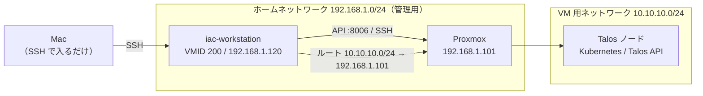

# IaC 作業用の Ubuntu VM

Proxmox 上に置く、IaC（OpenTofu / Ansible）と Talos クラスタの操作に使う Ubuntu VM。作業用のツールと秘密情報（OpenTofu の state、talosconfig、kubeconfig、Proxmox に入る SSH 鍵）をこの VM に集め、Mac からは SSH で入るだけにする。

この VM は、Proxmox の IaC（OpenTofu）の管理対象にしない。自分を動かしている VM を、自分の `apply` で作り直してしまわないようにするため。

## 構成



| 項目 | 値 |
|---|---|
| VMID / 名前 | `200` / `iac-workstation` |
| OS | Ubuntu 26.04 LTS（クラウドイメージ） |
| vCPU / RAM / ディスク | 2 / 4GB / 40GB（`local-lvm`） |
| ネットワーク | `vmbr0`、`192.168.1.120/24`、GW / DNS `192.168.1.1` |
| 追加のルート | `10.10.10.0/24` via `192.168.1.101`（netplan） |
| ユーザー | `ubuntu`（SSH の鍵認証だけ） |
| 自動起動 | `onboot: 1` |
| ゲストエージェント | 有効 |
| バックアップ | 毎週日曜 3:00 に `vzdump`（`local` に 4 世代） |

- ホームネットワークに置くので、Proxmox のファイアウォールのルールを変えずに、Proxmox の API と SSH に届く（ホームネットワークからの管理用アクセスは許可されている）
- `10.10.10.0/24` へのルートは VM 自身に入れる。ルーターの静的ルートを通らず、行きも帰りも Proxmox を直接通るので、経路が対称になる
- VM 用ネットワークからこの VM へ新しく接続することはできない（Proxmox のファイアウォールで `192.168.0.0/16` 宛てを落としている）

### 入れるツール

| ツール | バージョン | 入れ方 |
|---|---|---|
| OpenTofu | 1.13.9 | 公式の apt リポジトリ（`apt-mark hold` で固定） |
| Ansible | Ubuntu の apt（ansible-core 2.20） | apt |
| gh | 公式の apt リポジトリの最新 | apt |
| talosctl | v1.14.6 | GitHub のリリース（sha256 を確認） |
| kubectl | v1.37.1 | dl.k8s.io（sha256 を確認） |
| helm | v4.3.2 | get.helm.sh（sha256 を確認） |
| cilium CLI | v0.20.3 | GitHub のリリース（sha256 を確認） |
| qemu-guest-agent、git、jq | Ubuntu の apt | apt |

バージョンを上げるときは、`setup.sh` の先頭の変数を書き換えて実行し直す。

## ファイル

```
create-vm.sh  # VM の作成。Proxmox のシェルで実行する
setup.sh      # ルートとツールのセットアップ。VM の中で sudo で実行する（何度実行してもよい）
```

## 構築手順

### 1. VM の作成

Mac の公開鍵とスクリプトを Proxmox に送って実行する。

```bash
scp create-vm.sh ~/.ssh/<公開鍵>.pub root@192.168.1.101:/root/
ssh root@192.168.1.101 './create-vm.sh <公開鍵>.pub && rm create-vm.sh <公開鍵>.pub'
```

- Ubuntu のクラウドイメージ（`.img`）の中身は qcow2。`local` ストレージの `import` は拡張子でファイルの形式を判断し、`.img` は受け付けない（`unable to parse directory volume name`）ので、`.qcow2` の名前で保存している
- イメージは Ubuntu の `SHA256SUMS` で確かめてから取り込む。取り込みが終わったら（失敗したときも）、`/var/lib/vz/import/` から消す
- `qm create` のあとで失敗したら、作りかけの VM を `qm destroy --purge` で消す。残ると、VMID がすでにあるという確認で再実行できなくなる
- `current` のイメージを使うので、作るたびに中身が新しくなる
- cloud-init で渡すのは、ユーザー、公開鍵、IP だけ。追加のルートやパッケージを cloud-init で渡すにはスニペットのストレージが要るので、手順 2 で入れる

cloud-init が終わると、Mac から入れる（起動から 10 秒ほど）。

```bash
ssh ubuntu@192.168.1.120
```

### 2. セットアップ

```bash
scp setup.sh ubuntu@192.168.1.120:/tmp/
ssh ubuntu@192.168.1.120 'sudo /tmp/setup.sh'
```

- `qemu-guest-agent` は udev から起動される unit なので、`systemctl enable` はできない（警告が出る）。`setup.sh` では `start` だけしている
- tofu は `apt-mark hold` で固定している。`apt-get install -y` は hold されたパッケージを変えられない（`Held packages were changed and -y was used without --allow-change-held-packages`）ので、`--allow-change-held-packages` を付けて入れる
- ルートの付け先は、デフォルトルートのインターフェース（cloud-init の設定では `eth0`）にする
- `netplan apply` でネットワークが再設定されるので、名前解決できるようになるまで待ってからダウンロードを始める

### 3. Proxmox に入る SSH 鍵

VM の中で鍵を作り、Proxmox の `root` に登録する。Ansible で使う。

```bash
# VM の中で
ssh-keygen -t ed25519 -N "" -C "ubuntu@iac-workstation" -f ~/.ssh/id_ed25519
cat ~/.ssh/id_ed25519.pub   # Proxmox の /root/.ssh/authorized_keys に追記する
ssh-keyscan -t ed25519 192.168.1.101 >> ~/.ssh/known_hosts
ssh-keygen -lF 192.168.1.101   # Mac の known_hosts にある指紋と同じか確かめる
```

### 4. リポジトリと秘密情報

```bash
# VM の中で
git clone https://github.com/n-tanaka-idcf/talos-linux-poc.git ~/talos-linux-poc
gh auth login   # push するとき
```

Talos クラスタの `_out/`（talosconfig、kubeconfig、secrets.yaml）は、Mac から `scp -p` でコピーし、`chmod 600` にする。

### 5. バックアップのジョブ

Proxmox のシェルで実行する。

```bash
pvesh create /cluster/backup --schedule "sun 03:00" --vmid 200 --storage local \
  --mode snapshot --compress zstd --prune-backups keep-last=4 --enabled 1 \
  --comment "iac-workstation weekly"
```

- バックアップは Proxmox の中（`/var/lib/vz/dump/`）に置くので、Proxmox の故障には耐えない
- バックアップは VM のディスクを丸ごと、暗号化せずに保存する。Talos クラスタの `secrets.yaml`、talosconfig、kubeconfig、OpenTofu の state、Proxmox の `root` に入れる SSH 鍵も含まれる。Proxmox の `root` で読めるので、バックアップを Proxmox の外に持ち出すときは暗号化する

## 動作確認

```bash
# VM の中で
curl -sk -o /dev/null -w '%{http_code}\n' https://192.168.1.101:8006/api2/json/version   # 401（届いている）
ssh root@192.168.1.101 pveversion
timeout 4 bash -c '</dev/tcp/10.10.10.11/50000' && echo ok   # Talos API
timeout 4 bash -c '</dev/tcp/10.10.10.10/6443' && echo ok    # Kubernetes API（VIP）
```

2026-11-22 の確認結果:

- VM から、Proxmox の API と SSH、Talos API（`.11`、`.21`）、Kubernetes API（VIP `.10`）、インターネットに届いた
- Proxmox からゲストエージェント経由で VM の IP（`192.168.1.120`）が見えた
- VM 用ネットワークに置いた network namespace から、この VM の SSH（22）には届かなかった
- `_out/` をコピーしたあと、VM から `kubectl get nodes`（5 台とも Ready）、`talosctl health`、`cilium status` が通った
- `setup.sh` を 2 回続けて実行し、2 回目も正常に終わった
- tofu を 1.13.8 に下げて hold した状態で `setup.sh` を実行すると、1.13.9 に上がり、hold も残った（`--allow-change-held-packages` がないと、apt がエラーで止まることも確認した）
- VMID を 299 に変えた `create-vm.sh` に存在しない公開鍵を渡すと、イメージのチェックサムの確認と VM の作成のあと `qm set` で失敗し、VM 299 とイメージが消えた
- `vzdump 200 --storage local --mode snapshot --compress zstd` を手で実行し、48 秒で終わった（圧縮後 2.0GB）。ゲストエージェント経由で `fs-freeze` / `fs-thaw` が行われた
